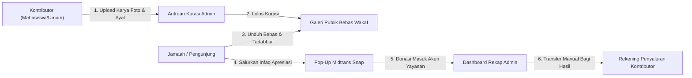
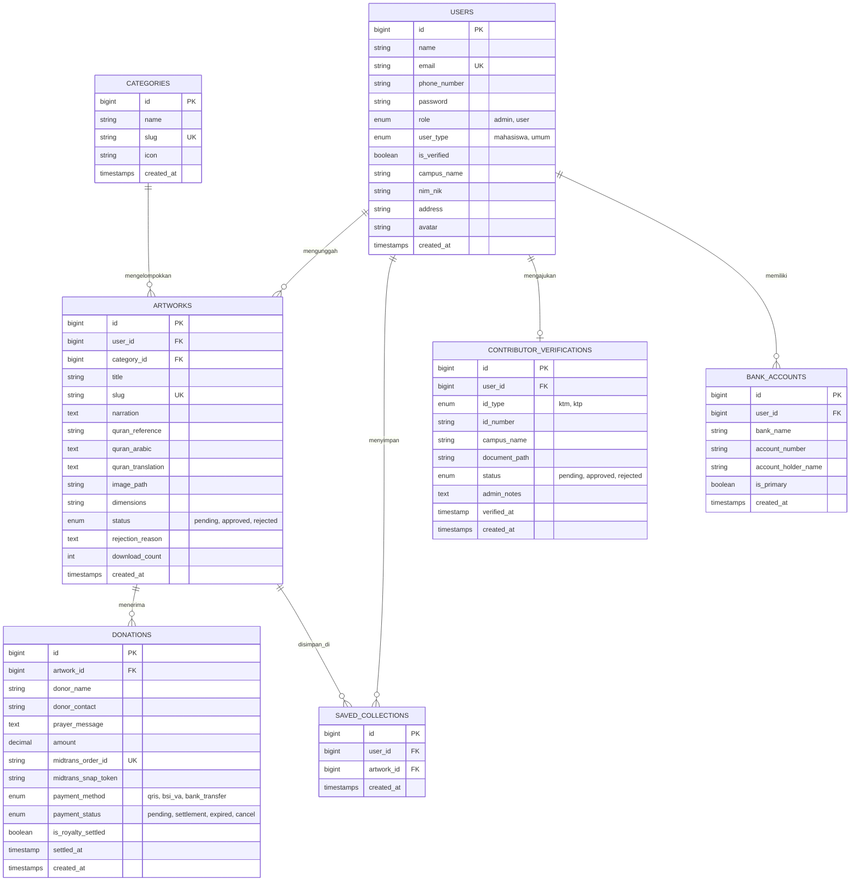
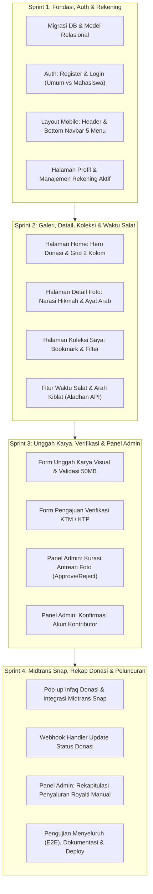

# 🌿 Product Requirement Document (PRD) & Desain Sistem Komprehensif
## Kuantum Pelopor Indonesia – Galeri Visual Islami, Wakaf & Donasi Dakwah

Dokumen PRD resmi, spesifikasi desain antarmuka, arsitektur data, dan roadmap pengerjaan terstruktur untuk sistem **Kuantum Pelopor Indonesia**. Dokumen ini telah disinkronkan 100% dengan seluruh aset desain, kode HTML, dan artefak antarmuka dari folder desain sistem resmi (`stitch_interactive_photo_gallery_donation`).

---

## 1. 📌 Ringkasan Eksekutif & Identitas Brand

**Kuantum Pelopor Indonesia** adalah platform galeri kurasi visual dakwah syariah modern yang memadukan keindahan karya fotografi Islami, arsitektur masjid, tadabbur alam, dan kaligrafi nusantara dengan **narasi hikmah** serta **kutipan ayat Al-Qur'an (teks Arab & terjemahan)**.

Platform ini hadir untuk memberdayakan insan kreatif (mahasiswa akademisi dan masyarakat umum) melalui konsep **Wakaf Visual Bebas Royalti** yang didukung dengan **Infaq & Donasi Dakwah Sukarela**.



### Prinsip Utama Sistem (Revisi Terverifikasi):
1. **Unduhan Bebas & Normal (Tanpa Paywall)**: Seluruh foto di galeri publik berlisensi *Bebas Wakaf* dan dapat diunduh langsung dalam resolusi tinggi tanpa harus berdonasi atau login terlebih dahulu.
2. **Infaq & Donasi Apresiasi Sukarela**: Donasi difasilitasi melalui pop-up interaktif berbasis Midtrans Snap (QRIS, BSI VA, dan Bank Transfer). Dana masuk ke rekening resmi yayasan/perusahaan.
3. **Verifikasi Bertingkat Akun Kontributor**:
   * Pendaftaran akun terbagi dua: **Umum** dan **Mahasiswa/Akademisi**.
   * Fitur rekening penyaluran donasi dikunci hingga pengguna mengunggah foto KTM/KTP dan disetujui secara manual oleh Admin di panel verifikasi.
4. **Bagi Hasil Royalti Transparan & Manual**:
   * Admin merekap perolehan donasi per karya di dashboard.
   * Admin menyalurkan bagi hasil secara manual ke nomor rekening aktif yang tertera di profil kontributor.
5. **Navigasi Mobile-First & Pengingat Ibadah**:
   * Bottom bar 5 menu: `Home` | `Jelajah` | `+ (Upload)` | `Koleksi` | `Waktu Salat`.
   * Menu **Waktu Salat & Arah Kiblat** menyajikan jadwal salat 5 waktu otomatis (Aladhan/Kemenag) dan kompas arah kiblat interaktif.

---

## 2. 🎨 Desain Sistem & Brand Identity (`DESIGN.md`)

Desain mengusung konsep **Refined Organic Editorial** yang menggabungkan ketenangan spiritual klasik Islam dengan kelincahan visual discovery engine modern.

### 2.1. Palet Warna (Color Tokens)
* **Surface Foundation**: `#F9F9F6` (Eggshell Paper halus) – memberikan kesan hangat, organik, dan tidak menyilaukan.
* **Primary Color**: `#0F382C` (Deep Emerald / Hijau Zamrud Tua) – melambangkan stabilitas, kedalaman spiritual, dan marwah dakwah. Digunakan untuk navbar, tombol aksi utama, dan heading utama.
* **Secondary / Accent**: `#D4AF37` / `#FED65B` / `#735C00` (Warm Metallic Gold) – aksen keemasan bernuansa mushaf untuk badge lencana, cincin fokus, dan sorotan nominal donasi.
* **Neutral Dark**: `#1A1C1B` (On-Surface Text) – hitam arang lembut untuk teks artikel agar nyaman dibaca lama.
* **Muted Variant**: `#717975` & `#C1C8C3` (Outline & Border) – garis pembatas tipis elegan bernuansa batu alam.

### 2.2. Tipografi (Typography)
* **Headlines & Judul**: `Noto Serif` (Serif editorial elegan dengan bobot SemiBold 600) untuk memberikan nuansa klasik karya sastra dan kurasi museum.
* **Body Text, Labels & Inputs**: `Plus Jakarta Sans` (Sans-serif modern, bersih, geometris) dengan keterbacaan tinggi di layar mobile.
* **Kutipan Arab**: Font Naskh / Amiri Quran dengan harakat lengkap dan ukuran proporsional.

### 2.3. Elevasi & Bentuk (Shapes & Elevation)
* **Radius Sudut**: `rounded-lg` (16px) untuk kartu foto masonry, `rounded-full` (9999px) untuk search bar dan chips kategori.
* **Bayangan (Emerald Shadows)**: Menggunakan bayangan bertingkat dengan rona emerald transparan (`rgba(15, 56, 44, 0.08)`) bukan hitam pekat, menciptakan ilusi kartu mengapung alami di atas kertas.

---

## 3. 📱 Arsitektur Antarmuka & Rincian Fitur (16 Layar Terintegrasi)

### 3.1. Halaman Beranda (`Home` - Mobile & Desktop)
* **Header Mobile**: Logo Kuantum Pelopor, Notifikasi Lonceng (Adzan/Apresiasi), Avatar Pengguna (menuju Profil).
* **Banner Donasi Terkumpul (Hero Section)**:
  * Widget total infaq terkumpul (*contoh: Rp 128.450.000 / Target Rp 150 Jt*).
  * Statistik muhsinin (donatur), persentase penyaluran dakwah, dan sisa hari program.
  * Tombol CTA: *"Salurkan Donasi"* (Emas) & *"Rincian Penyaluran"* (Garis tipis).
* **Search Bar & Category Ribbon**:
  * Input pencarian pintar (*"Cari karya dakwah, program sedekah, masjid, atau kaligrafi..."*).
  * Filter chips horizontal: `Semua`, `Masjid & Arsitektur`, `Alam & Tadabbur`, `Kegiatan Umat`, `Kaligrafi`, `Ramadhan`.
* **Koleksi Visual Pilihan (Grid 2 Kolom Mobile / 4-5 Kolom Desktop)**:
  * Thumbnail foto dengan badge kategori di kiri atas (*contoh: Arsitektur, Tadabbur*).
  * Tombol cepat simpan (Bookmark) di kanan atas kartu.
  * Judul karya, nama kontributor, dan badge lencana kurasi.
  * Tombol *"Muat Lebih Banyak Karya"*.
* **Tampilan Desktop Tambahan (`lihat_galeri_desktop`)**:
  * Tampilan *widescreen* responsif, toolbar sortir (`Terbaru`, `Terpopuler`), tombol cepat *"Unggah Karya Baru (Admin)"*, serta modal *"Pratinjau Cepat"* (*Quick View Zoom*).

### 3.2. Halaman Detail Foto & Pop-up Infaq Dakwah (`detail_foto_pop_up_donasi`)
* **Area Visual Utama**:
  * Foto resolusi penuh dengan badge lisensi (*Lisensi Bebas Wakaf*) dan badge resolusi (*Ultra HD 4K / 3840x2160 px*).
* **Konten Dakwah & Narasi**:
  * Label *SEDEKAH JARIYAH VISUAL* & tanggal publikasi.
  * Judul karya & subjudul filosofis.
  * Profil kontributor: Avatar berlingkar emas, nama lengkap, badge *Kontributor Visual Dakwah Terverifikasi*.
  * Kolom **Narasi Hikmah**: Refleksi tulisan dakwah mendalam mengenai pesan di balik potret visual.
  * Box **Ayat Al-Qur'an / Hadits**:
    * Rujukan Surah (*contoh: QS. An-Nur: 36*).
    * Teks Arab berharakat indah.
    * Terjemahan resmi bahasa Indonesia.
* **Sticky Action Bar Bawah**:
  * **Tombol Unduh (Download)**: Unduhan langsung 1-klik resolusi asli (gratis bebas wakaf).
  * **Tombol Infaq & Donasi Dakwah**: Memicu **Bottom Sheet Pop-Up Donasi**.
* **Fitur Pop-Up Infaq Donasi (Modal Interaktif)**:
  * Header: *"Infaq & Donasi Dakwah - Sedekah jariyah apresiasi karya visual umat"*.
  * Kartu mini karya yang diapresiasi (Thumbnail + Judul + Nama Kreator).
  * Chip pilihan nominal instan: `Rp 10.000`, `Rp 25.000`, `Rp 50.000`, `Rp 100.000`, `Rp 250.000`, `Rp 500.000`.
  * Input nominal kustom (Minimal Rp 5.000).
  * Input identitas:
    * Nama Donatur (Default: *Hamba Allah* atau nama pribadi).
    * Email atau No. WhatsApp (opsional untuk pengiriman bukti doa).
    * Doa / Pesan Kebaikan untuk Kontributor & Dakwah.
  * Pilihan Metode Pembayaran (Terhubung ke Midtrans):
    1. **QRIS (Semua Pembayaran Instan)**: GoPay, OVO, DANA, ShopeePay, BCA, Mandiri.
    2. **Bank Syariah Indonesia (BSI Virtual Account)**: Bebas biaya admin.
    3. **Transfer Antar Bank / VA Lainnya**: BCA, Mandiri, BRI, BNI.
  * Tombol CTA: *"Lanjutkan Pembayaran Infaq"* (Membuka Midtrans Snap).

### 3.3. Halaman Autentikasi Pengguna (`Daftar & Masuk`)
* **Pilihan Tab Akun (Dual Tab Switch)**:
  1. **Tab Umum**: Untuk penikmat karya visual dan masyarakat umum.
  2. **Tab Mahasiswa / Akademisi**: Untuk santri, mahasiswa, dan civitas kampus dengan fasilitas akses riset.
* **Form Pendaftaran Akun Baru (`daftar_akun`)**:
  * Input Nama Lengkap (sesuai kartu identitas).
  * Input Email Aktif.
  * Input Nomor WhatsApp / HP Aktif (format: `0812-xxxx-xxxx`).
  * Input Kata Sandi (minimal 8 karakter) & Konfirmasi Kata Sandi.
  * Checkbox persetujuan: *"Saya menyetujui Ketentuan Layanan & Kebijakan Privasi Dakwah"*.
  * Tombol *"Daftar Sekarang"* dan opsi *"Daftar dengan Google"*.
* **Form Masuk Akun (`masuk_akun_sederhana` & `masuk_akun_mahasiswa`)**:
  * Akun Umum: Email/Username, Kata Sandi, Ingat Saya, Masuk Google.
  * Akun Mahasiswa:
    * Dropdown/Autocomplete Perguruan Tinggi (*contoh: Universitas Gadjah Mada, UIN, dll.*) + tautan *"Kampus belum terdaftar? Tambahkan manual"*.
    * Nomor Induk (NIM / NIDN) atau Email Kampus (*contoh: nim@kampus.ac.id*).
    * Kata Sandi Portal.
    * Tombol *"Masuk Portal Akademik"* dan opsi *"Masuk dengan Google Workspace Kampus"*.

### 3.4. Alur Verifikasi Kontributor & Manajemen Rekening Penyaluran
* **Tahap 1: Verifikasi Akun & Unggah Identitas (`verifikasi_akun_rekening`)**:
  * Menampilkan informasi profil dasar (Nama, Domisili/Kecamatan, Email).
  * Pilihan jenis identitas: `Mahasiswa (KTM)` atau `Umum (KTP)`.
  * Input Nomor Identitas (NIM atau NIK e-KTP).
  * Area unggah berkas: *"Sentuh untuk Mengunggah KTM / KTP"* (Format JPG/PNG, maks 5MB, foto jelas terbaca).
  * Status fitur rekening bank: **Terkunci** (*"Terbuka otomatis pasca identitas disetujui tim kurator"*).
  * Tombol kirim: *"Kirim Verifikasi"*.
* **Tahap 2: Akun Terverifikasi & Rekening Aktif (`akun_terverifikasi_rekening_aktif`)**:
  * Lencana hijau: `Mahasiswa Terverifikasi` / `Kontributor Terverifikasi`.
  * Banner pengumuman: *"Identitas Anda telah diverifikasi oleh tim Kuantum Pelopor Indonesia. Rekening donasi dakwah aktif dan siap menerima penyaluran."*
  * **Kartu Rekening Penyaluran Aktif**:
    * Logo & Nama Bank (contoh: *Bank Syariah Indonesia / BSI*).
    * Nomor Rekening (*contoh: 7182 9384 1029*) dilengkapi tombol **Salin (Copy)**.
    * Nama Pemilik Rekening (Atas Nama: *GALIH WIRAGAMA*).
    * Status: *Pencairan donasi dakwah terhubung*.
  * Tombol Aksi: *"Ubah Rekening"* dan *"Tambah Rekening Lain"*.

### 3.5. Halaman Koleksi Saya (`koleksi_saya`)
* Header *"Koleksi Saya - Karya visual tersimpan & disukai"*.
* Filter koleksi cepat: `Semua (12)`, `Foto Favorit`, `Kaligrafi`.
* Grid 2 kolom kartu foto yang telah dibookmark.
* Tombol hapus/buka bookmark secara instan.
* State kosong (*Empty state*) ramah pengguna jika belum ada foto tersimpan.

### 3.6. Halaman Unggah Karya Visual (`tambah_karya_visual`)
* Header *"Unggah Karya"* dengan tombol tutup/batal.
* Area unggah berkas: Drag & drop atau sentuh untuk memilih foto (Format RAW, TIFF, PNG, JPEG hingga 50MB).
* Input Judul Karya * (Wajib).
* Pilihan Kategori * (Chip seleksi berikon):
  * 🕌 `Arsitektur` (Arsitektur masjid, pilar, kubah).
  * 🌿 `Alam` (Lanskap tadabbur, pegunungan, laut).
  * ✒️ `Kaligrafi` (Khath Diwani, Thuluth, Kufi).
  * 👥 `Kegiatan` (Halaqah, kajian pemuda, ukhuwah santri).
* Input Narasi Singkat / Refleksi Hikmah (Opsional).
* Input Ayat / Hadits Pendukung (Opsional):
  * Rujukan Surah (*contoh: QS. Ar-Ra'd: 28*).
  * Teks Arab & Terjemahan.
* Tombol CTA Bawah: *"Unggah Karya"*.
* Catatan transparansi: *"Karya yang dikirim akan masuk antrean kurasi admin terlebih dahulu sebelum diterbitkan ke galeri publik."*

### 3.7. Halaman Waktu Salat & Arah Kiblat (`waktu_salat_arah_kiblat`)
* Header brand dengan tombol aktivasi notifikasi adzan.
* **Banner Waktu Salat Terdekat**:
  * Menampilkan nama salat dan jam (*contoh: Ashar — 15:18 WIB*).
  * Penghitung mundur (*contoh: "34 menit lagi menuju Ashar"*).
* **Kompas Arah Kiblat Interaktif**:
  * Visual kompas bergradasi hijau zamrud dan jarum emas penunjuk Ka'bah.
  * Menggunakan sensor `DeviceOrientationEvent` pada browser mobile.
  * Teks panduan: *"Putar perangkat hingga jarum emas sejajar dengan simbol Ka'bah."*
* **Daftar Jadwal 5 Waktu Salat Lengkap**:
  * Subuh, Terbit (Syuruq), Dzuhur, Ashar, Maghrib, Isya.
  * Waktu otomatis dihitung via Aladhan API berdasarkan Geolocation pengguna (standar Kemenag RI).

### 3.8. Panel Dashboard Admin (`panel_admin`)
Tersedia dua modul administrasi utama sesuai desain resmi:

#### A. Panel Kurasi & Antrean Foto Umat (`panel_admin_kurasi_antrean_foto_umat`)
* **Kartu Ringkasan Status**:
  * `Menunggu Review`: 8 foto baru (Badge kuning *Perlu Tindakan*).
  * `Disetujui / Tayang`: 45 karya aktif (Badge hijau *Galeri Aktif*).
  * `Ditolak`: 3 foto (Badge merah *Tidak Sesuai Etika*).
* **Toolbar Penyaring**: Tab `Semua`, `Menunggu Review`, `Disetujui`, `Ditolak`, Pencarian judul/pengunggah, dan dropdown kategori.
* **Daftar Antrean Moderasi**:
  * Thumbnail foto, status, kategori, waktu kirim.
  * Judul karya & ringkasan narasi.
  * Nama kontributor & komunitas/asal (*contoh: Ahmad Fauzi | Santri Krapyak*).
  * Tombol Aksi: `Setujui` (Hijau), `Tolak` (Merah dengan form alasan), dan ikon pratinjau penuh.

#### B. Panel Konfirmasi Akun Kontributor (`panel_admin_konfirmasi_akun`)
* **Kartu Statistik Verifikasi**:
  * Menampilkan antrean aktif (*contoh: 6 Berkas Menunggu Konfirmasi*).
  * Tab filter: `Semua (95)`, `Menunggu Verifikasi (6)`, `Mahasiswa (KTM)`, `Umum (KTP)`, `Terverifikasi`.
* **Daftar Antrean Permohonan**:
  * Nama pemohon (*contoh: Fajar Shadiq Pratama*), alamat email, nomor WhatsApp aktif, institusi kampus (*contoh: Universitas Gadjah Mada*), nomor induk identitas.
  * Tombol: `Tinjau Berkas & Detail`, `Setujui`, `Tolak`.
* **Drawer / Modal Detail Verifikasi**:
  * Pratinjau foto dokumen KTM/KTP beresolusi tinggi (dapat di-zoom).
  * Form input *"Catatan Admin Verifikator (Opsional)"*.
  * Aksi persetujuan langsung yang membuka fitur rekening pada profil kontributor.

---

## 4. 🗄️ Skema Database & Relasi Entitas (ERD)



---

## 5. 🗓️ Roadmap Pengerjaan & Task Breakdown (4 Minggu Magang)

Rencana kerja bertahap yang realistis dan terukur untuk diselesaikan dalam **1 bulan hari kerja**:



### Checklist Detail Pengerjaan Mingguan:

#### 🏁 Minggu 1: Skema Database, Autentikasi & Profil Pengguna
- [ ] Inisialisasi tabel database: `users`, `bank_accounts`, `contributor_verifications`, `categories`, `artworks`, `saved_collections`, `donations`.
- [ ] Buat Seeder Kategori (*Arsitektur, Alam, Kaligrafi, Kegiatan*) dan Akun Admin default.
- [ ] Implementasi form **Daftar Akun Baru** (Pemisah tab Umum & Mahasiswa, no WhatsApp, checkbox privasi).
- [ ] Implementasi form **Masuk Akun** (Umum & Mahasiswa dengan autocomplete kampus).
- [ ] Bangun layout mobile responsif: Header atas (Profil avatar & Lonceng) + Bottom Navigation Bar 5 menu (`Home`, `Jelajah`, `+`, `Koleksi`, `Waktu Salat`).
- [ ] Implementasi halaman **Profil Pengguna**:
  - Tampilan status verifikasi (Terkunci vs Terverifikasi).
  - Manajemen rekening bank penerima penyaluran donasi (*BSI/BCA/dll.*, fitur salin no rekening).

#### 🎨 Minggu 2: Galeri Publik, Halaman Konten & Fitur Ibadah
- [ ] Bangun halaman **Home Galeri Mobile**:
  - Banner target donasi terkumpul (*Donasi Terkumpul, Progress Bar, Tombol Salurkan*).
  * Filter chips horizontal kategori.
  * Grid masonry 2 kolom dengan kartu foto ber-badge.
- [ ] Bangun halaman **Detail Foto**:
  - Penampil foto resolusi tinggi berlisensi bebas wakaf.
  - Kartu kontributor dakwah.
  - Box narasi hikmah reflektif.
  - Box kutipan ayat Al-Qur'an (Teks Arab berharakat & terjemahan).
  - Tombol aksi: Unduh 1-klik normal dan tombol buka pop-up infaq.
- [ ] Implementasi fitur **Koleksi Saya**:
  - Tombol bookmark pada kartu foto untuk menyimpan ke koleksi pribadi.
  - Halaman `/koleksi` dengan filter tab.
- [ ] Implementasi fitur **Waktu Salat & Arah Kiblat**:
  - Integrasi API Aladhan publik berbasis Geolocation HTML5.
  - Tampilan jadwal 5 waktu salat dan hitung mundur salat berikutnya.
  - Visual kompas penunjuk Ka'bah berbasis sensor orientasi perangkat.

#### 🛡️ Minggu 3: Unggah Karya, Verifikasi Dokumen & Kurasi Admin
- [ ] Buat halaman **Unggah Karya Visual**:
  - Form upload gambar (JPG/PNG, drag & drop).
  - Pilihan kategori berikon (*Arsitektur, Alam, Kaligrafi, Kegiatan*).
  - Input judul, narasi hikmah, dan rujukan ayat Al-Qur'an.
  - Penanganan file upload ke storage lokal Laravel (`storage/app/public`).
- [ ] Buat form **Pengajuan Verifikasi Identitas**:
  - Input NIM/NIK dan upload foto KTM / KTP.
- [ ] Bangun **Panel Admin - Kurasi Foto**:
  - Halaman antrean moderasi foto dengan filter status (*Menunggu Review, Disetujui, Ditolak*).
  - Aksi persetujuan (*Setujui*) dan penolakan (*Tolak* beserta alasan).
- [ ] Bangun **Panel Admin - Konfirmasi Akun**:
  - Daftar antrean verifikasi berkas mahasiswa/umum.
  * Modal penampil foto kartu identitas (KTM/KTP).
  * Aksi verifikasi yang langsung mengaktifkan fitur rekening pada akun pengguna terkait.

#### 💳 Minggu 4: Pembayaran Midtrans Snap, Rekap Penyaluran & Finalisasi
- [ ] Pasang library resmi Midtrans PHP (`composer require midtrans/midtrans-php`).
- [ ] Buat komponen **Bottom Sheet Pop-up Infaq Donasi**:
  - Pilihan nominal instan (*Rp 10k, 25k, 50k, 100k, 250k, 500k*) dan nominal kustom.
  - Form nama donatur, no WhatsApp/email, doa/pesan berkah.
  - Pilihan metode bayar (QRIS, BSI VA, Bank Lainnya).
  - Integrasi JavaScript Midtrans Snap untuk memunculkan pembayaran instan.
- [ ] Buat endpoint Webhook Midtrans (`/api/midtrans-callback`) untuk mengupdate status donasi otomatis menjadi `settlement`.
- [ ] Buat halaman **Rekapitulasi Donasi Admin**:
  - Tabel perolehan donasi per foto dan per kontributor.
  - Menampilkan nama kontributor, nomor rekening bank aktif, dan status transfer manual.
- [ ] Pengujian menyeluruh (*End-to-End Testing*):
  - Alur daftar -> verifikasi KTM -> upload foto -> kurasi admin -> donasi Midtrans Sandbox -> rekap transfer manual.
- [ ] Pembersihan kode (*code formatting*), dokumentasi README GitHub, dan persiapan laporan magang.

---

## 6. 🚀 Panduan Menjalankan Sistem Lokal

```bash
# 1. Clone & Masuk Direktori
cd c:\laragon\www\SistemDonasi_Syariah

# 2. Install Dependensi PHP & Node
composer install
npm install

# 3. Setup File Konfigurasi .env
cp .env.example .env
php artisan key:generate

# 4. Hubungkan Storage Publik
php artisan storage:link

# 5. Jalankan Migrasi Database & Seeder
php artisan migrate --seed

# 6. Kompilasi Aset & Jalankan Server
npm run dev
php artisan serve
```
